# East Africa crop shortfall advisor: project report

*Prepared November 2026. Prototype for evaluation; not an operational forecast.*

## 1. Summary

We set out to turn a small public-domain dataset on East African agriculture into something a farm
advisory tool, drought monitor or crop insurer could use. The result is a model that flags, for each
country and crop, whether the coming harvest is likely to fall more than 10% below its recent average.

- On 12 years of data the model never saw (2013-2024), it ranks risky cases well: **ROC-AUC 0.81**.
- Cases it placed in the "Very high" risk band ended in a shortfall **66%** of the time; cases in the
  "Low" band did so **7%** of the time. The overall rate was 22%.
- Class balancing mattered: it raised the share of shortfalls caught from **26% to 58%**.
- Two findings limit how it should be used. Most of the skill comes from recent yield history rather
  than weather, and the companion yield estimate does not beat a "same as last year" guess.

## 2. What we were trying to achieve

The seed dataset describes itself as baseline knowledge for agricultural advisory and drought tools. The
practical question such tools face is: *which crops, where, are heading for a poor season?* We framed
that as two prediction tasks:

1. **Shortfall risk (main model):** will national yield fall below 90% of its previous 5-year average?
2. **Expected yield (secondary):** what yield is likely, in kg per hectare?

## 3. The data

### 3.1 The seed dataset

The supplied file holds **8 records**: 4 crops (sorghum, finger millet, cassava, cowpea), 1 tree
(moringa), 1 rainfall zone, 1 soil type and 1 water feature. All values are free text and the dataset
card states they are unverified. Eight records cannot train or test a model, so we used them in two ways:

- parsed into structured crop profiles (water need, yield range, season, soil, storage) shown in the app;
- compared against modern data as a sanity check (figure below).

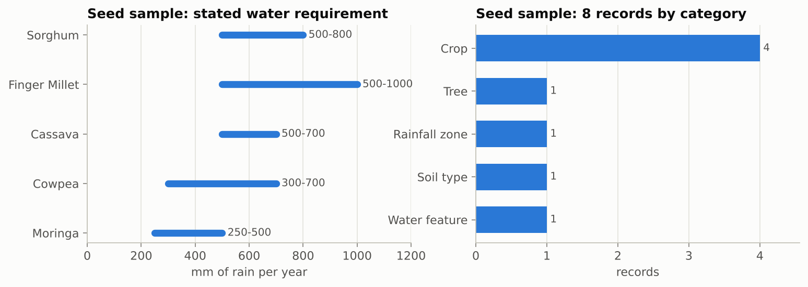
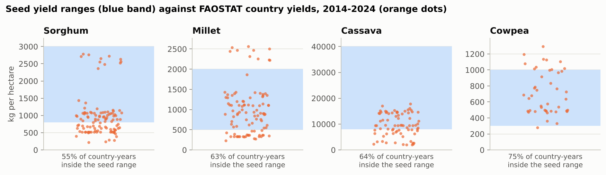

Between 55% and 75% of modern national yields for the four seed crops fall inside the historical ranges
in the seed file. Sorghum and cassava often fall *below* the stated minimum, so the seed ranges read as
attainable yields rather than typical national averages.

### 3.2 Augmentation with open data

| Source | What it adds | Volume |
|---|---|---|
| FAOSTAT crop statistics | Yield, area and production by country, crop and year, 1976-2024 | 15,232 values selected |
| NASA POWER (MERRA-2) | Monthly rainfall and temperature, 1981-2024, at 48 farming locations | 25,344 monthly records |

Countries: Burundi, Eritrea, Ethiopia, Kenya, Rwanda, Somalia, South Sudan, Sudan, Tanzania, Uganda.
Crops: maize, sorghum, millet, wheat, rice, beans, cowpea, pigeon pea, groundnuts, sesame, cassava,
sweet potato, potato, banana.

A soil source (ISRIC SoilGrids) was also planned, but the service did not respond reliably during the
build. Soil is constant per country in this design, so it would not have added predictive information.

### 3.3 Cleaning

| Issue found | Count | Action |
|---|---|---|
| Missing yield values | 11 | Dropped |
| Harvested area under 500 ha (unstable ratios) | 45 | Dropped |
| Yield identical to the previous year (carried-forward estimates) | 305 | Excluded as prediction targets |
| Jumps of more than 3x against neighbouring years | 9 | Excluded |
| Too little history to compute a 5-year average | 134 | Dropped |
| Values flagged "estimated" by FAO rather than official | about 36% | Kept, and reported as a limitation |

Reported yields were cross-checked against production divided by area; none differed by more than 5%.
The final modelling table has **4,131 country-crop-year rows** and 27 input features.

## 4. Data analysis

### 4.1 Univariate

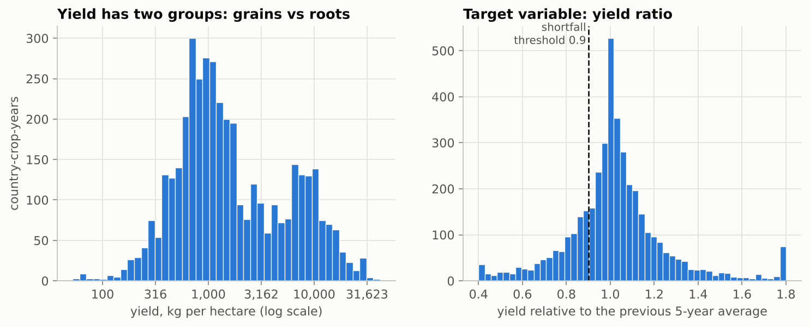
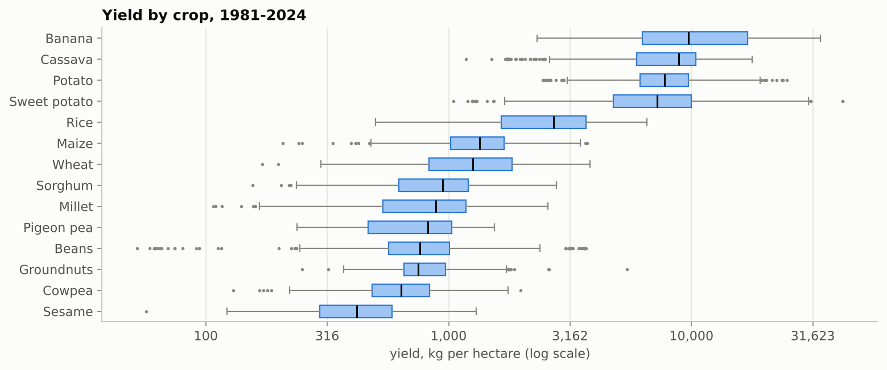

Yields form two groups: grains and pulses around 1,000 kg/ha, and roots and bananas around 8,000 kg/ha.
The model therefore works with yield *relative to each crop's own recent average*, which puts all crops
on one scale.

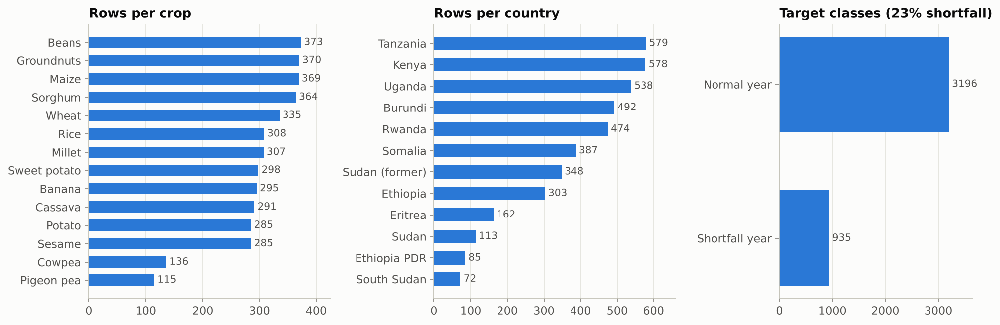

Two imbalances appear. Crops are unevenly represented (373 rows for beans, 115 for pigeon pea), and the
target is skewed: **23% shortfall years against 77% normal years**.

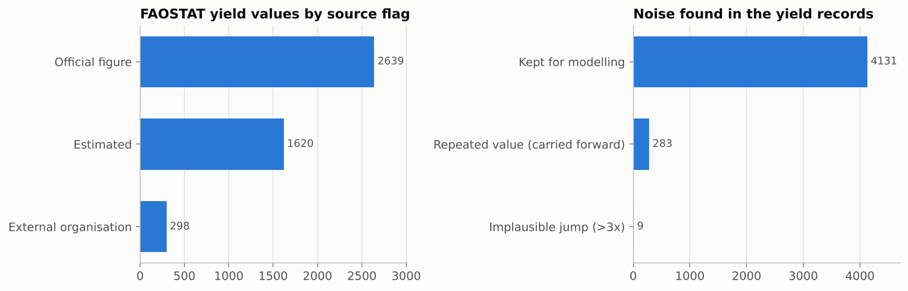
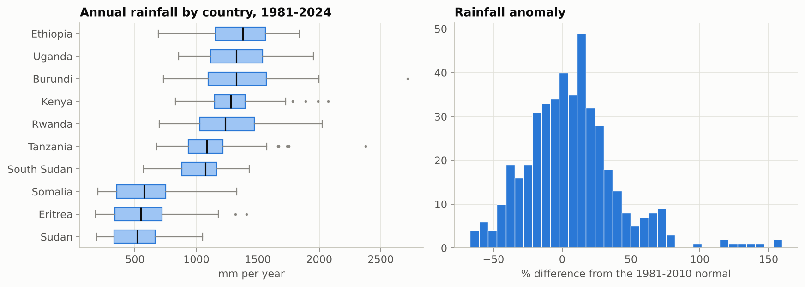

### 4.2 Bivariate

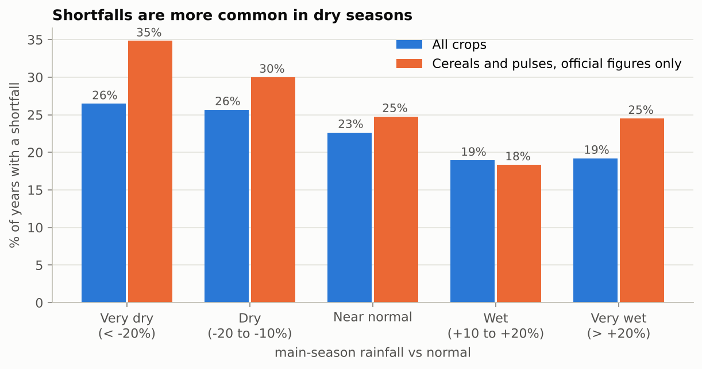

Shortfalls are more common in dry seasons: 26% of very dry seasons against 19% of wet ones. The effect
is stronger for cereals and pulses with official figures (35% against 18%).

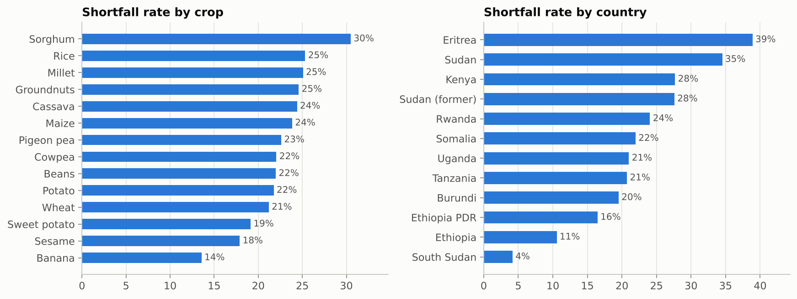
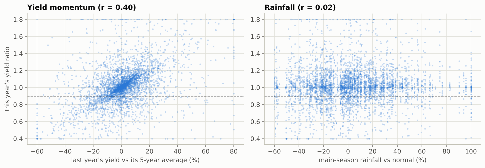

Yield momentum (last year against the 5-year average) correlates 0.40 with the outcome. Seasonal
rainfall correlates only 0.02 in a straight-line sense, although the banded chart above shows a real,
modest effect.

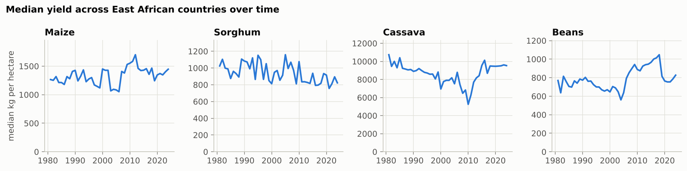

### 4.3 Multivariate

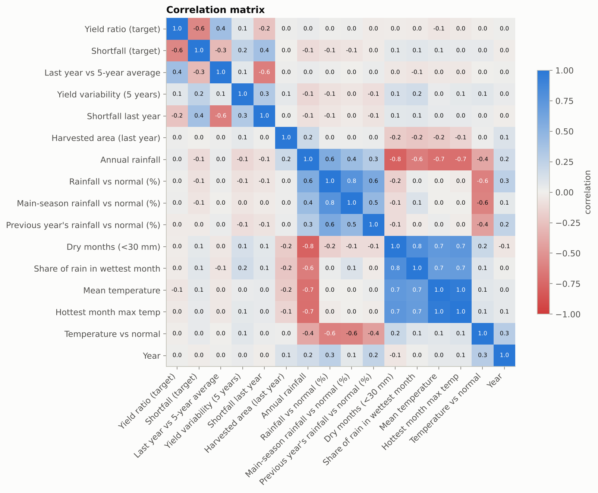

Climate variables are strongly inter-correlated (wetter places are cooler), which favours a regularised
model over one that treats each variable independently.

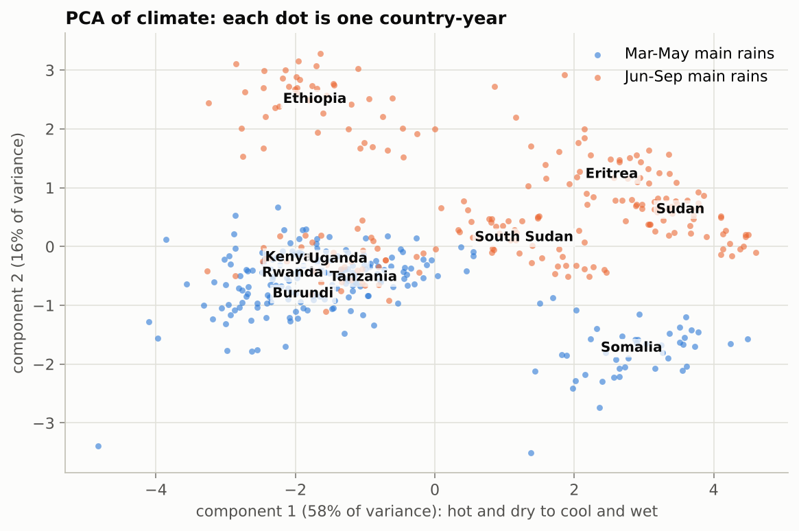

Two principal components capture 74% of the climate variation and separate three groups: the cool, wet
equatorial highlands (Kenya, Uganda, Rwanda, Burundi, Tanzania, Ethiopia), the hot Sahel belt (Sudan,
Eritrea, South Sudan) and Somalia.

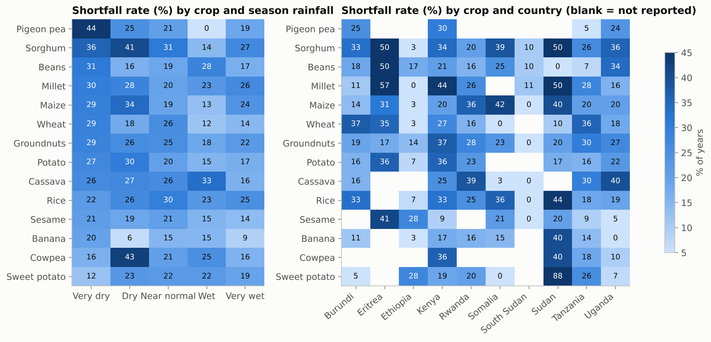

Sensitivity to dry seasons differs by crop: pigeon pea, sorghum and beans show the largest rise in
shortfalls when the season is very dry.

## 5. Modelling

### 5.1 Design

- **Train:** 1981-2012 (2,913 rows). **Test:** 2013-2024 (1,218 rows). Splitting by time mirrors real
  use and prevents the model from seeing the future.
- **Validation:** four expanding-window folds inside the training years.
- **Features:** yield history (last year, 5-year average, variability, previous shortfall), harvested
  area, weather for the season (annual and seasonal rainfall, anomalies against the 1981-2010 normal,
  dry months, temperature) and identifiers (crop, crop group, country, main rainy season).

### 5.2 Balancing and model selection

Three model families were each tried with five balancing strategies. Cross-validation results:

| Model | Balancing | PR-AUC | ROC-AUC | Balanced accuracy | Recall |
|---|---|---|---|---|---|
| Logistic regression | None | 0.451 | 0.705 | 0.577 | 0.203 |
| Logistic regression | Class weights | 0.454 | 0.708 | 0.670 | 0.580 |
| Logistic regression | Random oversampling | 0.446 | 0.704 | 0.666 | 0.594 |
| Logistic regression | SMOTE | 0.443 | 0.704 | 0.656 | 0.580 |
| **Logistic regression** | **Random undersampling** | **0.453** | **0.710** | **0.675** | **0.626** |
| Random forest | None | 0.443 | 0.706 | 0.568 | 0.174 |
| Random forest | Class weights | 0.437 | 0.709 | 0.677 | 0.543 |
| Random forest | Random oversampling | 0.437 | 0.704 | 0.678 | 0.503 |
| Random forest | SMOTE | 0.430 | 0.704 | 0.669 | 0.479 |
| Random forest | Random undersampling | 0.431 | 0.707 | 0.674 | 0.636 |
| Gradient boosting | None | 0.415 | 0.689 | 0.587 | 0.238 |
| Gradient boosting | Class weights | 0.416 | 0.689 | 0.667 | 0.553 |
| Gradient boosting | Random oversampling | 0.406 | 0.689 | 0.671 | 0.551 |
| Gradient boosting | SMOTE | 0.406 | 0.705 | 0.626 | 0.345 |
| Gradient boosting | Random undersampling | 0.415 | 0.681 | 0.653 | 0.602 |

Without balancing, every model missed about four in five shortfalls. All balancing methods fixed this to
a similar degree; the differences between them are small. **Logistic regression with random
undersampling** was selected on combined rank of PR-AUC and balanced accuracy. It is also the simplest
and most explainable option, which suits a tool that third parties need to trust.

### 5.3 Results on unseen years (2013-2024)

| Measure | Selected model | Same model, no balancing | No-skill reference |
|---|---|---|---|
| ROC-AUC | 0.81 (0.77 to 0.84) | 0.81 | 0.50 |
| PR-AUC | 0.62 (0.56 to 0.68) | 0.63 | 0.22 |
| Shortfalls caught (recall) | 58% | 26% | 0% |
| Flags that were right (precision) | 55% | 80% | n/a |
| Balanced accuracy | 72% | 62% | 50% |

Of 265 real shortfalls, the model flagged 154 and missed 111. Of 953 normal years, it raised 128 false
alarms.

| Risk band | Cases | Ended in a shortfall |
|---|---|---|
| Low | 687 | 7% |
| Moderate | 252 | 25% |
| High | 103 | 35% |
| Very high | 176 | 66% |

Performance by crop ranges from ROC-AUC 0.87 (rice) to 0.71 (millet); cassava has the weakest recall (33%).

### 5.4 Where the skill comes from

| Inputs used | ROC-AUC on test years |
|---|---|
| Yield history only | 0.82 |
| Weather and location only | 0.61 |
| All features | 0.81 |

This is the most important caveat. The model mainly detects crops that are already in a slump or have
unstable yields. Weather on its own has modest skill, and adds nothing on top of yield history at
national, annual scale. National averages smooth out local droughts, and one weather value per country
per year is a blunt measure.

### 5.5 Yield estimate

| Method | Mean absolute error | Median % error |
|---|---|---|
| Gradient boosting model | 468 kg/ha | 6.1% |
| Baseline: same as last year | 416 kg/ha | 4.9% |
| Baseline: 5-year average | 595 kg/ha | 8.6% |

The yield model does not beat the simplest baseline. It is kept in the app as a scenario indicator only.

## 6. The application

`app/streamlit_app.py` has four tabs:

- **Try the model:** pick a country and crop, move rainfall and temperature sliders, and see the risk
  band, risk score, expected yield, a rainfall sensitivity curve and the seed crop profile.
- **Is the model working?:** the test results above, the confusion matrix, the balancing comparison, the
  most influential inputs, and a table of every past prediction marked as correct warning, false alarm,
  missed shortfall or correct all-clear.
- **Data analysis:** all figures in this report.
- **About and limits.**

## 7. How this can help

- **Early warning:** official yield statistics arrive a year or more late. A risk band available at the
  end of the season can direct attention to the country-crop pairs most likely to disappoint.
- **Advisory tools** (such as the kilimo-mcp and wapimaji-mcp agents named by the dataset): the model
  and cleaned tables give those agents a measured, testable signal in place of unverified notes.
- **Insurance and planning:** the risk bands have known hit rates, which is the starting point for
  pricing or for deciding when to trigger a review.

## 8. Limits

- Predictions are national averages. They say nothing about a district or a farm.
- Skill comes mainly from yield history; the rainfall slider moves the score only modestly.
- About 36% of the FAOSTAT yields used are estimates, and estimated series are smoother than reality.
- Country weather is the mean of 4 to 6 chosen locations, not an area-weighted average of cropland.
- The risk score is not a calibrated probability; use the bands.
- The seed records remain unverified against their cited originals.

## 9. Recommended next steps

1. Move to sub-national data (district yields, CHIRPS rainfall on cropland, vegetation indices). This is
   where weather is expected to carry real signal.
2. Verify the seed records against the cited sources and extend them to more crops.
3. Calibrate the risk score and agree a cost-based threshold with the intended users.
4. Deploy the app on a hosted service and collect feedback from advisers.

## 10. Reproducing the work

All code is in `src/`; see the README for the commands. Random seeds are fixed.
